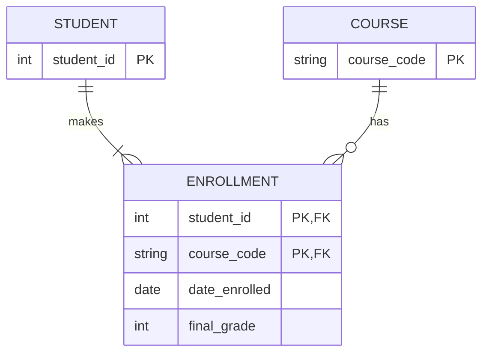
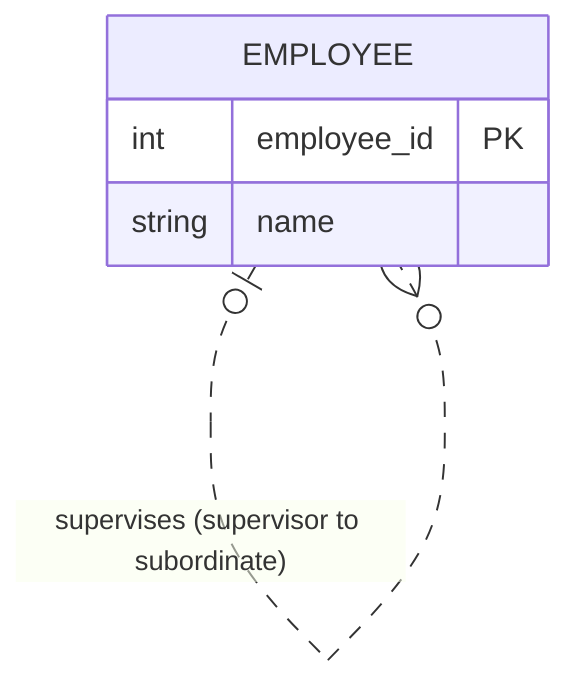
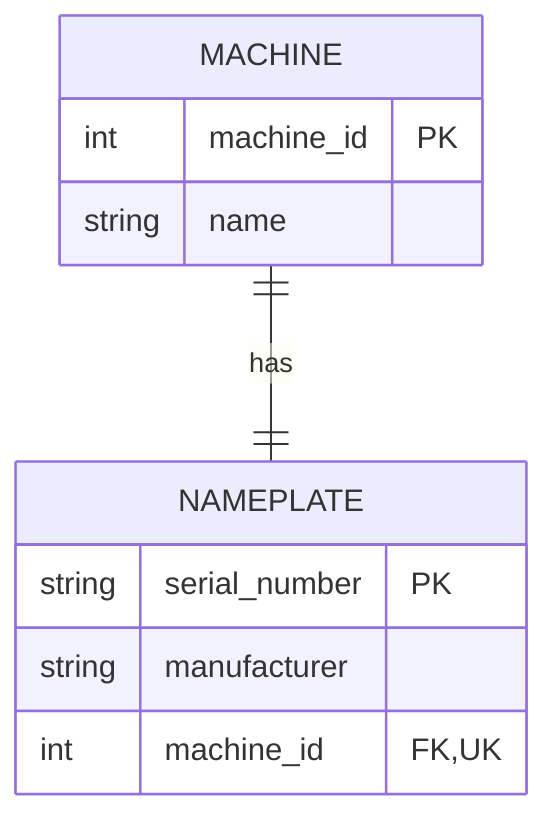
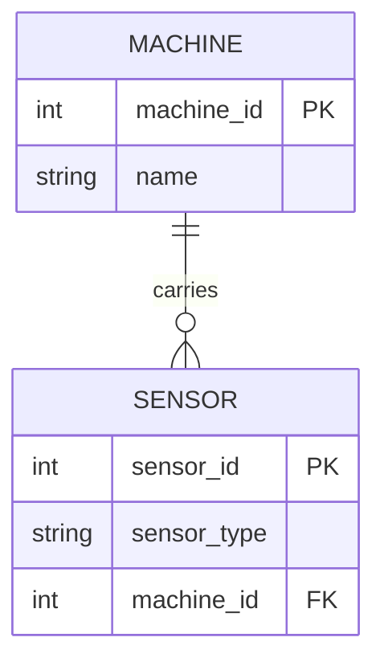
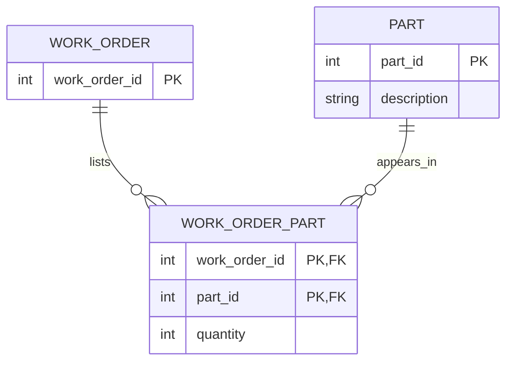
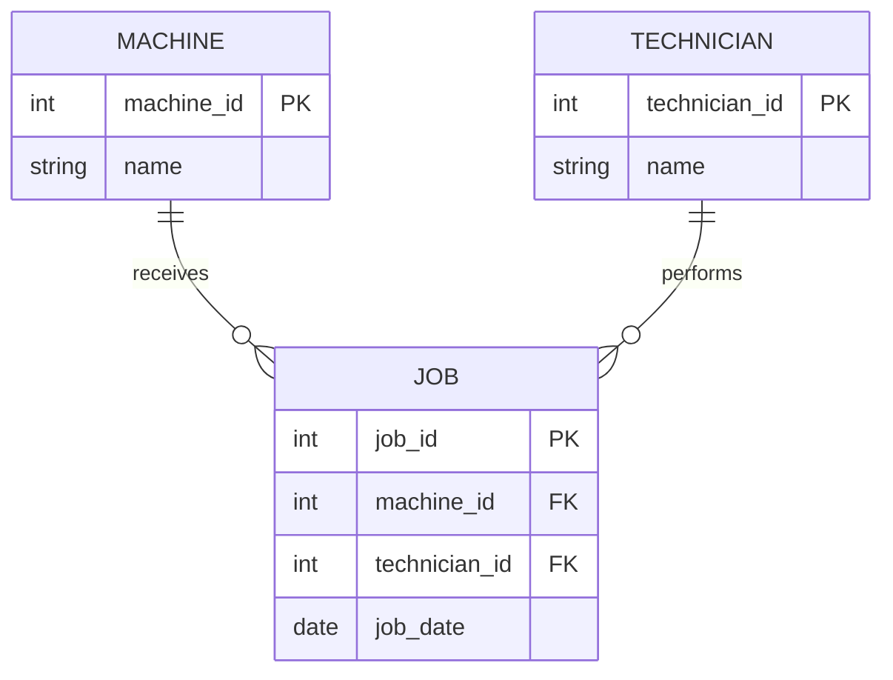

# Module 2 study log

## References we used

| Source | Concept I understood best |
|---|---|
| [Entity–relationship model](https://en.wikipedia.org/wiki/Entity%E2%80%93relationship_model) | An ER model describes entities, their attributes, and relationships; cardinality says how many entities can participate. Crow's-foot ends distinguish zero, one, and many. |
| [Enhanced ER model](https://en.wikipedia.org/wiki/Enhanced_entity%E2%80%93relationship_model) | A subtype is a more specific kind of a supertype and inherits its common attributes, such as `Student` inheriting from `Person`. |
| [Natural key](https://en.wikipedia.org/wiki/Natural_key) and [surrogate key](https://en.wikipedia.org/wiki/Surrogate_key) | A natural key uses a real-world value; a surrogate key is an assigned identifier. A natural-looking value is not a reliable key unless it is unique and constrained. |
| [First normal form](https://en.wikipedia.org/wiki/First_normal_form) | A comma-separated list puts several independently useful values into one cell, making them difficult to query and update individually. |
| [SQLite foreign keys](https://sqlite.org/foreignkeys.html) | SQLite disables foreign-key enforcement by default for backwards compatibility, so applications must enable it on each connection. |
| [Pydantic](https://docs.pydantic.dev/) | Pydantic uses Python type hints to parse and validate data before application code uses it. |
| [SQLAlchemy](https://docs.sqlalchemy.org/) | SQLAlchemy lets Python code describe database tables and work with SQL through Core or the ORM. |
| [diagrams.net](https://www.diagrams.net/) | It can be used to draw and export ER diagrams; the diagram file can be saved locally. |

## Things I looked up

| Topic | What I found | Source |
|-------|---------------|--------|
| ER model and cardinality | Entities have attributes and relationships; cardinality describes the minimum and maximum participation, such as one machine to many jobs. | [ER model](https://en.wikipedia.org/wiki/Entity%E2%80%93relationship_model) |
| Crow's-foot notation | A circle means zero, a bar means one, and the three-pronged symbol means many. | [ER model: Crow's-foot notation](https://en.wikipedia.org/wiki/Entity%E2%80%93relationship_model#Crow's_foot_notation) |
| EER inheritance | Subtypes inherit common attributes and can add attributes of their own. | [Enhanced ER model](https://en.wikipedia.org/wiki/Enhanced_entity%E2%80%93relationship_model) |
| Why SQLite foreign keys need enabling | They are off by default for backwards compatibility; use `PRAGMA foreign_keys = ON` for each connection. | [SQLite foreign-key support](https://sqlite.org/foreignkeys.html) |
| First Normal Form (1NF) | A cell should hold one value. A comma-separated list, such as P-1001,P-1002, hides multiple values and makes them harder to query separately. | https://en.wikipedia.org/wiki/First_normal_form |

## Remarkable things

- The `machine_name` value looked like a key in the legacy database, but the schema did not declare it unique or reference it with a foreign key.
- The part number `P-1003` appears twice, so the apparent natural key is not actually enforced.
- Job 1's `P-1001,P-1002` value looks readable to a person, but a normal equality join cannot match either part separately.
- The date pattern query catches `unknown`, but matching the `YYYY-MM-DD` shape alone cannot prove a value is a real calendar date.

## LLM Q&A

**Prompt used with ChatGPT:** “Given the SQLite tables `maint_job(job_id, parts_used)` and `part(part_no, description)`, is `JOIN part p ON p.part_no = j.parts_used` correct for listing every job-part relationship? Explain what it will miss.”

**Answer summary:** No. Equality compares the entire `parts_used` text with one `part_no`, a value such as `P-1001,P-1002` cannot match either individual part. A normalized `job_part(job_id, part_no)` junction table is the reliable design.

**Verification:** I ran the equality join in [`integrity-audit.sql`](integrity-audit.sql). It omitted job 1, which lists two parts. It also returned job 2 twice because the legacy `part` table contains duplicate `P-1003` rows. The query’s output confirmed the answer.

## Two ER/EER examples I want to remember

### University registration ERD — associative entity

Source: [University Registration Data Model Example, Figure A.1](https://eng.libretexts.org/Bookshelves/Computer_Science/Databases_and_Data_Structures/Database_Design_2e_(Watt)/01:_Chapters/1.17:_Appendix_A_-_University_Registration_Data_Model_Example).

My redraw of the Student–Enrollment–Course portion:



What I learned: `Enrollment` resolves a many-to-many student/course relationship and can store facts about that particular enrollment, such as date and grade. A relationship can need its own attributes.

### Employee supervision — recursive relationship

Source: [George Washington University, ER Model Notes, recursive SUPERVISION example](https://www2.seas.gwu.edu/~bhagiweb/cs2541/lectures/ER.pdf), slides 55–58.

My redraw (the two appearances of `EMPLOYEE` have different roles):



What I learned: one entity type can participate twice in one relationship. Role names matter: the first employee is the supervisor and the second is the subordinate. A supervisor can have many reports; a top-level employee can have no supervisor.

## Task B: from words to sketch

### 1. Machine and nameplate (1:1)

The nameplate can be a separate entity if we need to store and manage its serial number and manufacturer explicitly. In that design, `machine_id` is a unique, required foreign key in `Nameplate`, so each machine and nameplate correspond to exactly one another. If the nameplate has no separate meaning in the system, its fields could instead be attributes of `Machine`.



### 2. Machine and sensors (1:n)

A sensor belongs to one machine; a machine can have many sensors. The foreign key goes on the many side, in `Sensor`.



### 3. Work orders and parts (m:n)

Use a junction table. The composite key prevents listing the same part twice on one work order.



### 4. Maintenance job, machine, and technician

`Job` is an entity because it has its own date and links a machine with a technician. A technician is an entity, not just a repeated name, because one technician can perform many jobs and can be identified consistently.



### Cardinality proof: sensors per machine

I inserted two sensor rows for one machine and counted them. This demonstrates one machine can have many sensors.

```sql
PRAGMA foreign_keys = ON;

CREATE TABLE Machine (
    machine_id INTEGER PRIMARY KEY,
    name TEXT NOT NULL
);

CREATE TABLE Sensor (
    sensor_id INTEGER PRIMARY KEY,
    sensor_type TEXT NOT NULL,
    machine_id INTEGER NOT NULL REFERENCES Machine(machine_id)
);

INSERT INTO Machine (machine_id, name)
VALUES (1, 'CNC-01');

INSERT INTO Sensor (sensor_id, sensor_type, machine_id)
VALUES (101, 'temperature', 1), (102, 'vibration', 1);

SELECT Machine.name, COUNT(Sensor.sensor_id) AS sensor_count
FROM Machine
JOIN Sensor ON Sensor.machine_id = Machine.machine_id
GROUP BY Machine.machine_id;
```

Observed result from running the SQL in an in-memory SQLite database:

```text
name    sensor_count
CNC-01  2
```

The runnable proof is also saved as [`cardinality-proof.sql`](cardinality-proof.sql).

## Agreed learning (pod discussion)

_Add the points your pod and neighboring pod actually agreed on, and record any open disagreement. Do this after the discussion._
