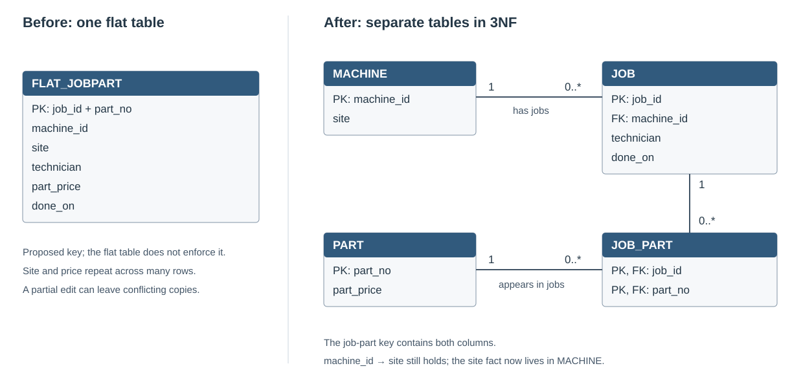
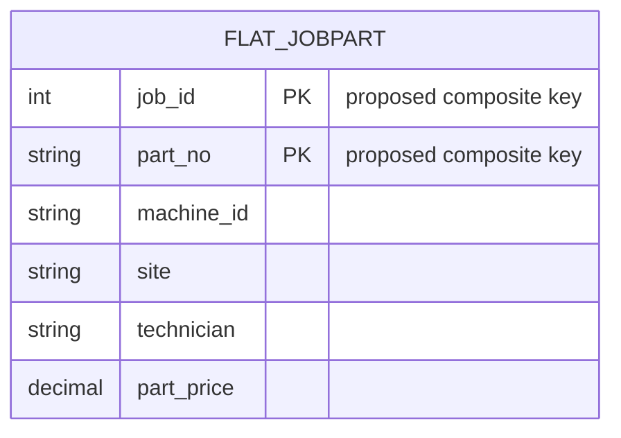
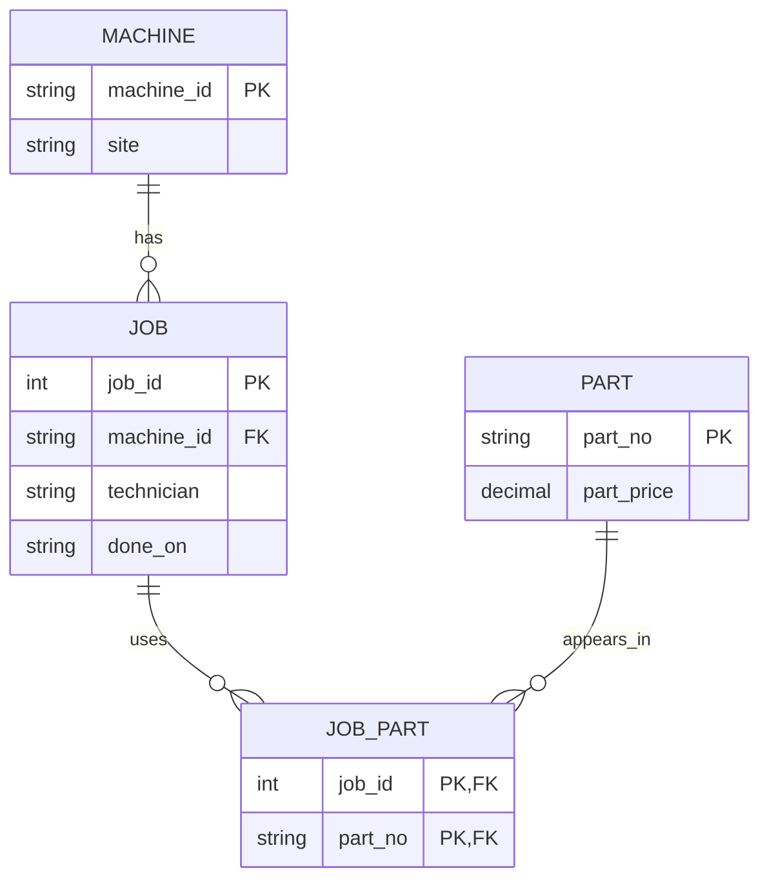

# Round 1 — Dependencies and two ER sketches

Naming the dependencies, deciding which ones are real rules, and comparing the two ER sketches were difficult for me. The distinction I want to remember is between a business rule and a pattern in a small sample. Five rows can disprove a dependency, but matching values in those five rows do not guarantee it will hold for future data.

## The starting sample

| job_id | machine_id | site | technician | part_no | part_price |
| --- | --- | --- | --- | --- | --- |
| 1 | cnc-01 | Gütersloh | tech-0 | P-0001 | 6.00 |
| 1 | cnc-01 | Gütersloh | tech-0 | P-0002 | 7.00 |
| 2 | cnc-02 | Gütersloh | tech-1 | P-0001 | 6.00 |
| 2 | cnc-02 | Gütersloh | tech-1 | P-0003 | 8.50 |
| 3 | cnc-01 | Gütersloh | tech-0 | P-0003 | 8.50 |

## FD list and the assumptions behind it

`X → Y` means that rows agreeing on X must agree on Y.

For example, job 1 appears twice, with different parts, but both rows name tech-0. If one technician per job is the rule, knowing the job tells me the technician. Knowing only the job does not tell me the part: that is why the row needs both job and part in its key.

| Dependency | Status | Reason |
| --- | --- | --- |
| `job_id → machine_id, technician` | Domain assumptions for this lab | Each job concerns one machine and has one technician. The sample is consistent with this, but it cannot establish the business rule by itself. |
| `machine_id → site` | Domain assumption for this lab | A machine has one current site. A historical site at the time of a job would need a different model. |
| `part_no → part_price` | Domain assumption for this lab | One current catalog price per part. Negotiated or historical prices would need additional attributes and a different key. |
| `(job_id, part_no) → all columns` | Candidate-key assumption | A job lists a part at most once. Job alone is not enough because a job can use several parts; part alone is not enough because several jobs can use it. |
| `machine_id → technician` | Only observed in these five rows | A machine could be maintained by another technician on a later job. |
| `technician → machine_id` | Only observed in these five rows | One technician can work on several machines. |
| `part_price → part_no` | Only observed in these five rows | Different parts could have the same price. |
| `∅ → site` | Only observed in these five rows | All five happen to have the same site. Other sites can exist. |

The larger lab also includes `job_id → done_on`: each job has one recorded date. Its generator does not keep one technician per machine, which provides a counterexample to the sample-only `machine_id → technician` pattern.

The flat table's values are already atomic, so it is already in 1NF. For 2NF, job details and part price must leave the composite-key row because they depend on only one part of that key. For 3NF, the site moves out of job details and into MACHINE: `job_id → machine_id → site` is the extra step that explains where the site comes from.

## Before — one row tries to describe several things

The key shown is the proposed logical key. The unconstrained `flat5` table in Round 2 does not actually declare or enforce it. Machine site, job technician and part price repeat across its rows.

## After — separate facts, linked by keys

My answer to “which arrow disappears?” needs care: the true dependency `machine_id → site` does not stop being true. It moves into `MACHINE`, so `site` no longer repeats on job-part rows. Similarly, part price belongs to `PART`, while the technician and date belong to `JOB`.

The sketches are separate before/after views on this page. They show how the same facts can be represented with different amounts of repetition.

## AI comparison and verification

The supplied handout included this prompt alongside the five rows:

> Here is a flat table: &lt;columns and the five rows&gt;. List the functional dependencies you can infer, and mark which are domain facts and which are only observed in these rows.

The proposed list above keeps the job, machine and part rules as assumptions about this lab. Machine-to-technician, technician-to-machine, price-to-part and the constant site are only patterns in the sample. They should not be treated as permanent rules.

The anomaly script supplies concrete checks for why the dependencies matter: one partial update creates conflicting sites, an unused part requires NULL placeholders, and deleting a job loses the only record of a part's price. [SQL](anomalies.sql) · [Actual output](evidence/anomalies.txt)

For the lab's model, `(job_id, part_no)` is minimal: each component alone appears on multiple sample rows. To challenge the sample-only dependencies, I can add another job for cnc-01 with tech-1, or another part with price 6.00. Neither violates the intended lab model, but each defeats one of those extra guesses.

## Round 2 — the anomalies in SQL

| Anomaly | Statement | Result in the saved experiment |
| --- | --- | --- |
| Update | `UPDATE flat5 SET site='Bielefeld' WHERE machine_id='cnc-01';` | Three rows must change to edit one machine fact. Updating only one copy leaves conflicting sites. |
| Insert | `INSERT INTO flat5 VALUES (NULL,NULL,NULL,NULL,'P-0004',9.00);` | SQL accepts the row because the table permits NULL, but it does not describe a real job-part use. A separate part table can store the part without a job. |
| Delete | `DELETE FROM flat5 WHERE job_id=1;` | Two rows disappear, including the only row saying P-0002 exists and costs 7.00. |

The two-connection experiment also shows a second writer receiving `database is locked` while the first holds its write transaction. After it retries and commits a different partial edit, the machine still has inconsistent site copies. SQLite's writer lock controls simultaneous writes; it does not know that those repeated sites are supposed to mean one fact. [SQLite transaction documentation](https://www.sqlite.org/lang_transaction.html)

The INSERT example deliberately does **not** claim a constraint error. `flat5` has no key or NOT NULL rules, so the anomaly is the awkward representation, not rejection by SQLite. [SQLite CREATE TABLE documentation](https://www.sqlite.org/lang_createtable.html)

My next step is to compare this with my first FD list and discuss the differences at the neighbour gate.
