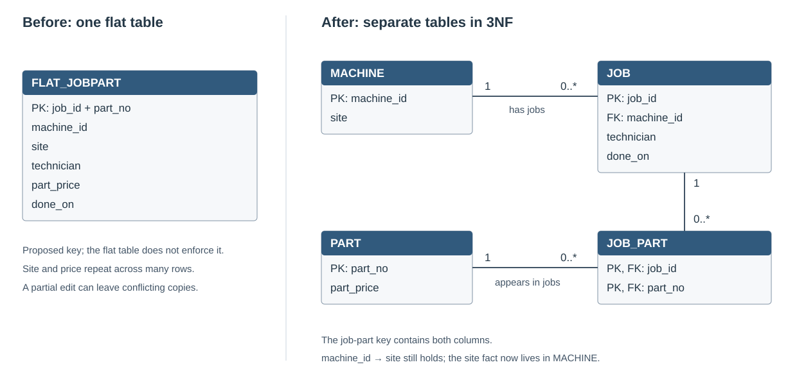

# Module 5 — My normalization notes

The idea I want to remember is that normalization gives each fact a clear place to belong. Denormalization repeats some of those facts to make a read easier, so I need to measure the benefit and decide how the copies stay correct.

## Round 1 — dependencies and keys

This was the difficult part for me: naming the FDs, deciding whether they were domain rules or just observations, and drawing the before/after ER sketches.

`X → Y` means that knowing X gives one answer for Y. It does not mean that each X occurs only once in the table. Job 1 can occur on several part rows while still having one technician.

| FD | Why it belongs in the lab model |
| --- | --- |
| `job_id → machine_id, technician, done_on` | A job has one machine, one technician and one recorded date. |
| `machine_id → site` | The lab models one current site per machine. |
| `part_no → part_price` | The lab models one current catalogue price per part. |
| `(job_id, part_no) → all columns` | This identifies a job-part row, assuming each part is listed at most once per job. |

These are assumptions about the domain. The five rows agree with them, but five rows cannot guarantee a rule for all future data. The apparent `machine_id → technician` rule is only observed in that small sample: another technician can work on the same machine later. The larger dataset demonstrates that counterexample.

The candidate key needs both columns. `job_id` alone repeats when a job uses several parts, while `part_no` alone repeats when several jobs use the same part.

The [FD comparison page](fd-comparison.md) contains the five-row sample, the proposed dependencies and editable Mermaid diagrams. It explains why the smaller sample can suggest rules that do not hold in the larger dataset.

## How I explain 1NF, 2NF and 3NF

| Form | My explanation | What changes in this example |
| --- | --- | --- |
| 1NF | Each field contains one value for the thing it represents. | The supplied flat table already has individual part numbers. The comma-list from Module 2 would need separate job-part rows. |
| 2NF | A non-key attribute must depend on the whole candidate key, rather than only part of a composite key. | Job details depend on `job_id`; price depends on `part_no`. Separate JOB, PART and JOB_PART. |
| 3NF | Remove the transitive dependency between the job and its machine's site. | Move site to MACHINE, leaving the machine key on JOB. |

After the 2NF step, a job table could still contain `job_id, machine_id, site, technician, done_on`. Its key is just `job_id`, so there is no partial-key problem, but `job_id → machine_id → site` still means site is repeated across jobs. Moving site to MACHINE is the 3NF step.

The real `machine_id → site` rule does not disappear after normalization. Its information is stored once in MACHINE instead of on every job-part row. Price being TEXT is a separate type issue; that alone is not a 1NF violation.

## Round 2 — the three anomalies

The [SQL](anomalies.sql) and [actual output](evidence/anomalies.txt) use fresh copies of the five rows so one example does not hide another.

| Anomaly | What happens |
| --- | --- |
| Update | Moving cnc-01 needs three row updates for one site fact. Changing only one copy leaves conflicting sites. |
| Insert | An unused part can only be squeezed into this flat design with unrelated NULL job fields. SQLite accepts that placeholder row because the table has no constraints. |
| Delete | Deleting job 1 also deletes the only row recording P-0002 and its price. |

The two-session example showed a writer lock, followed by successful sequential partial updates that still left different sites for the same machine. SQLite controls simultaneous writes; it does not know that all those site copies should agree.

## Round 3 — building and checking the 3NF design

The [setup](setup.sql) uses `CROSS JOIN` to create **20,000 × 10 = 200,000 rows**. The [normalization script](normalize.sql) loads the four related tables with foreign keys enabled and explicit NOT NULL rules on the non-integer/composite keys.

| Table | Rows |
| --- | ---: |
| flat_jobpart | 200,000 |
| machine | 50 |
| part | 10 |
| job | 20,000 |
| job_part | 200,000 |

Part has ten rows because `k` runs only from 1 to 10. Applying `% 40` to those ten numbers does not generate forty different parts. The generated part numbers are P-0002 to P-0011, with prices 6 through 15. The five-row introductory example uses different sample values and is not a literal extract of this generated data.

The [build evidence](evidence/build.txt) checks the source count, junction count and actual four-table join count. It also compares the rows with EXCEPT in both directions: zero missing rows and zero extra rows. This is stronger than checking equal row counts alone. Foreign-key checking found no violations.

`SELECT DISTINCT` assumes that repeated descriptions of the same job agree. It cannot resolve two different technicians for one job; those rows would clash with the job's primary key. The script also checks the proposed dependencies in the generated data before treating the decomposition as consistent.

## Round 4 — comparing the dashboard reads

The normalized query joins JOB, MACHINE, JOB_PART and PART. The [report table](report.sql) copies their columns onto each job-part row. It still has to aggregate the selected rows; it is not a table of precomputed totals.

Both queries have one untimed warm-up. The [benchmark](bench.py) then alternates their order across five measured runs and reports the median. The timer includes fetching every result row, and all result values are compared. The [benchmark table](benchmark-results.md) and [raw plans](evidence/benchmark.txt) contain the actual numbers.

The query uses `done_on >= '2026-03-01'`, not a moving last-90-days window. It returns 350 machine/technician groups and a total of 722,610.0 from 68,820 matching job-part rows. Those are the same for both designs.

The index experiment compares `SCAN report_jobpart USING INDEX ix_report_machine` with `SCAN report_jobpart` after the index is dropped. The first still visits the whole index; it is not a selective SEARCH. The report was faster without that index in the saved experiment. The normalized timing also changed between phases, so I should compare the paired results and avoid attributing the whole time change to one cause.

## Round 5 — paying for the repeated facts

Changing cnc-02's site touched **one MACHINE row versus 4,000 report rows**. After the normalized update alone, the report had 4,000 stale site copies. Updating the report repaired the mismatch; both sites were restored afterwards so later experiments started from the same facts.

The [measured table](benchmark-results.md) includes update times and storage. The handout's dbstat query counts table pages only, so the results also show table-plus-index totals, including primary-key indexes. The flat source and optional wider experiment are excluded from those design totals. If the normalized source is kept, the report is additional storage.

## Round 6 — my recommendation

My [memo to Yasmin Kaya](recommendation.md) uses the measured times, rows touched and storage. The transactional tables should stay normalized. A reporting copy needs a defined refresh process, a last-refreshed timestamp and a decision about how stale the dashboard may be.

A scheduled rebuild targets a refresh interval; it cannot guarantee a strict maximum age if the rebuild is slow or fails. Maintaining a copy immediately would need to cover every affected insert, update and delete across the source tables, not just one site-update trigger.

## Round 7 — curiosities and optional experiments

My [harvest list](curiosities.md) collects the questions and their sources. The [wider comparison](benchmark-results.md#optional-wider-comparison) adds vendor and site details in a separate report, leaving the main experiment intact. The [DuckDB comparison](duckdb-results.md) checks the same data in another engine with loading excluded from query timing.

The price rule also needs a business decision: one current catalogue price per part is different from the actual price charged for a past job. A charged price can properly belong on JOB_PART. Similarly, a machine's current site is different from the site it occupied when the job happened.

## Checking the results

The FD question in the task asks which dependencies are domain rules and which are just observations. The [FD page](fd-comparison.md) lists the proposed rules and the assumptions behind them.

The saved tests compare full reconstructed rows, query results, plans, repeated timings, update counts and object storage. Those checks matter because a claim such as “one table must be faster” is not enough. The source scripts, versions and raw output make the work reproducible.

## My round gates

| Round | Technical artefact | Neighbour gate |
| --- | --- | --- |
| 1 | FD list and diagrams saved; comparison with my own first list still to add | Not yet recorded |
| 2 | SQL and broken rows saved | Not yet recorded |
| 3 | Counts and complete reconstruction checked | Not yet recorded |
| 4 | Results, timings and plans saved | Not yet recorded |
| 5 | Rows changed, storage and index comparison saved | Not yet recorded |
| 6 | Recommendation written | Read-aloud and what-if question still to record |
| 7 | Curiosities collected | Swap and course-format feedback still to record |

Questions to take to my pod: what assumption makes `(job_id, part_no)` a key, and should our report use current part prices or historical charged prices? I still need to add the actual feedback from the gates and harvest exchange.

[Module 5](README.md) · [Sources and curiosities](curiosities.md) · [Reflection 5](../Reflections/ref05.md)
