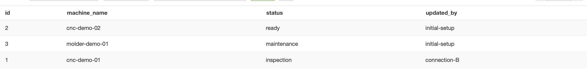

# Module 6b — Choosing the shape and the engine

My main question in this module is whether different workloads really need different engines. The decision should depend on the data and the evidence, including the extra work involved in keeping another copy up to date.

## Learning goals

- Query and index SQLite JSON fields.
- Measure a key/value workload and choose a storage shape.
- Explain ACID, BASE and the CAP theorem using the lab examples.
- Defend an engine choice with a result from the portfolio.
- Explain what changes with a shared database server.

## Task 1 — Shared PostgreSQL activity

The two-writer exercise used row 1 of the class-server demo table. The two connections were checked using pg_backend_pid: A was 33694 and B was 33673.

### Three observations

1. **Easier:** both connections used the same central table and familiar SQL. After a committed change, the other connection could see the result without copying a local database file.
2. **Harder:** I had to keep track of the connection and whether its transaction was committed. A saw running/connection-A while B still saw the last committed ready/reset value. B's later UPDATE waited until A committed.
3. **Failure mode:** pgweb remained open, but a query failed with connection refused when PostgreSQL could not be reached. Later queries worked again. The separate database service added a failure point; the cause of that interruption was not independently verified.

### Concurrency result

B displayed “Please wait, query is executing...”. A then queried pg_stat_activity. The result showed B waiting on a transaction lock and pg_blocking_pids identified A as its blocker:

| Connection | Backend PID | State in the lock snapshot | Blocked by |
| --- | ---: | --- | ---: |
| A | 33694 | active, running the diagnostic query | none |
| B | 33673 | active, waiting on Lock / transactionid | 33694 |

After COMMIT in A, B completed. Its result was id=1, status=inspection, updated_by=connection-B. Pgweb reported 36,808 ms including the wait; that is not a normal update-latency benchmark.

The earlier reset result did not mean A's update failed: B was reading the committed version while A's change was still uncommitted. After the service interruption and reconnection, the row was ready/reset and the test was repeated with new backend connections.

[SQL used](server_bench.sql) · [Complete observed sequence](evidence/postgres-server-test.txt) · [Lock snapshot](evidence/postgres-row-lock.csv) · [Final result](evidence/postgres-final-result.csv)

The pgweb screenshot shows the final state of `cnc-demo-01`: `inspection`, updated by `connection-B`. The lock snapshot above records the wait.




## Task 2 — JSON metadata and session state

### JSON metadata

[json_bench.py](json_bench.py) creates **1000 devices** with vendor-specific fields. JSON properties can be missing without adding a new SQL column. The example also adds service_interval_days to cnc-01 while the table still has only device_id, name and meta.

The two queries return the same **334 Fanuc devices**:

```sql
SELECT name FROM device
WHERE json_extract(meta,'$.vendor')='Fanuc';
```

```text
SEARCH device USING INDEX ix_device_vendor (<expr>=?)
```

```sql
SELECT name FROM device
WHERE meta ->> 'vendor'='Fanuc';
```

```text
SCAN device
```

**The shorthand loses this index because the query uses a different expression from the json_extract expression that was indexed.** SQLite does not automatically rewrite these two expressions into the same indexed form. [Expression-index documentation](https://sqlite.org/expridx.html)

The constraint rejected malformed JSON with `CHECK constraint failed: json_valid(meta)`. A valid scalar such as 42 still passed, so json_valid checks syntax, not whether the document has the object shape or vendor types the application expects. These rules would need extra checks. [Full output](evidence/json-output.txt)

I would keep the vendor document next to its relational device row. This makes adding optional vendor fields easier and keeps the possibility of joining device information to other tables. Frequently queried fields still need suitable indexes and documented types. JSON is flexible storage, not permission to ignore the shape of the data.

### Session-state benchmark

The fixture uses 20,000 key/value pairs. These are medians of three fresh-store runs after a warm-up, with test order alternated. `shelve` set timing includes sync and SQLite includes a transaction commit; those calls do not prove identical durability. [Script](kv_compare.py) · [All timings](evidence/kv-output.txt)

| Operation, 20,000 keys | shelve | SQLite |
| --- | ---: | ---: |
| Set | 0.642 s | 0.010 s |
| Get | 0.038 s | 0.065 s |

The shelve backend here is **dbm.sqlite3**. On this machine, shelve itself uses SQLite underneath, so this compares its dictionary/serialization API with a direct SQL table. The transaction, batching and serialization paths differ. It is not proof that every key-value engine has these timings.

I would ship **SQLite** for this dashboard's session state. Shelve read faster in this run; the complete table above and the existing use of SQLite matter more than one lookup timing alone. SQLite also supports transactions and SQL questions across sessions; the test counted 5,000 values matching city:1. Shelve provides key access, so that kind of filter would require Python iteration. The current fixture stores no timestamps, so neither version can answer “last week” without recording that information.

This is still a key-value-shaped workload even when its storage is a two-column SQL table. A document is useful when I query several properties; a key/value entry is useful when I already have the key. A relational table adds constraints, joins and queries across records. The session choice uses measured values rather than the class reference numbers.

## Task 3 — My decision record

| Workload | Engine / shape | Why | Evidence | Cost accepted | If stale or missing |
| --- | --- | --- | --- | --- | --- |
| Two-year month-end report | Parquet + DuckDB | Fast grouped history reads | 6a: 2M rows; 696.5 → 5.6 ms; Parquet 2.46 MB | Scheduled copy, extra storage and export work | Mark its age; rebuild, or use SQLite when current data is required |
| Sensor/job ingest every 30 s | SQLite transactions + constraints + UPSERT | Local writes, enforced rules and replay without duplicate readings | M4: 1 → 4 → 4 rows after two imports; bad sensor and range rejected | One writer at a time; correct durability settings; no power-loss test recorded | Lost committed ingest is unacceptable; recover from the source/replay log and investigate |
| Vendor metadata gaining fields | JSON column in SQLite | Optional fields stay next to relational data | 1,000 devices; 334 matching rows; SEARCH with json_extract, SCAN with shorthand; invalid JSON rejected | Validate important property types and keep indexed expressions consistent | Missing fields can hide calibration needs; show unknown and correct the source record |
| Dashboard session state | SQLite key/value table | Existing engine, transactions and cross-session queries | 20k sets: 0.010s; gets: 0.065s; shelf 0.642s / 0.038s | A little SQL and expiry logic; keep actual tokens out of Git | Ask the user to log in again or reset filters; source machine data stays intact |
| Concurrent network users | Shared PostgreSQL | Central copy, independent connections and controlled conflicting writes | A 33694 blocked B 33673; B completed after COMMIT; service failure/recovery observed | Server/network operations and credentials; handle waits/retries | An unreachable database stops queries even while pgweb is available |

**If Kortmann could run only one engine, I would choose SQLite.** It can handle the writes, JSON metadata and session lookups, and it can still run the report. The reporting workload would become painful first: the same dashboard took about 696.5 ms instead of 5.6 ms in the saved 6a comparison. More concurrent writers would be another reason to revisit the choice. This does not mean a crash or a network partition has been tested just because a database supports transactions.

The report numbers are reused from the saved Module 6a run, not remeasured in this module. The ingest evidence is from [Module 4's double-run check](../Module04/evidence/upsert.txt) and [constraint errors](../Module04/evidence/constraints.txt). The new JSON and key/value numbers are in this module's evidence folder.

### Pod discussion and defence notes

- **Which row has no evidence?** The four required rows have measurements or recorded checks. The extra PostgreSQL row now also has an observed lock and connection-failure/recovery result.
- **Where is data duplicated, and who updates it?** Parquet is a reporting copy. The proposed scheduled refresh and its owner are described in the [6a memo](../Module06a/memo.md); the freshness timestamp and failed-job alerts are part of that operating decision.
- **What happens with two writers?** PostgreSQL showed B waiting on A (33694). Once A committed, B completed its update. Atomic updates and careful transaction boundaries still matter.
- **Why a database rather than spreadsheets?** Keys, constraints and transactions enforce relationships and write rules, while SQL expresses the report and checks across rows. A second copy still needs an explicit refresh policy.

I would ask the other pod how long they would trust the Parquet copy after a failed refresh. My proposed change to the report row is to show the last successful refresh time and use SQLite when current data is needed. That makes it clear which copy the supervisor is looking at.

## Project ticket and reflection

[Project ticket](project-ticket.md) · [Reflection 6b](../Reflections/ref06b.md)

## Running the local work

```sh
uv run python Module06b/run_checks.py
```

This rebuilds this module's generated device table and runs the JSON and key/value experiments. It does not run Task 1 or connect to PostgreSQL. Session stores are temporary and removed at the end. To update this page from the latest saved measurements:

```sh
uv run python Module06b/write_notes.py
```

Commit the scripts, Markdown and small evidence text/JSON files. Keep polyglot.db and any sessions files out of Git; shelve can create files with suffixes other than .db.

## Theory I want to remember

- ACID describes transaction guarantees. SQLite uses transactions and its journaling mechanisms; running on one machine alone is not what guarantees ACID, and distributed systems can also provide ACID transactions.
- BASE accepts some temporarily inconsistent state in exchange for availability in an appropriate distributed design.
- CAP concerns a distributed system during a network partition. It does not mean “choose any two” as an everyday database setting. Its consistency is not the same definition as ACID's constraint consistency.
- A JSON format is not an engine choice. The JSON column still has rules: valid syntax, expected keys/types and indexes for the queries that matter.

## Sources

- [SQLite JSON](https://sqlite.org/json1.html) and [expression indexes](https://sqlite.org/expridx.html).
- [SQLite isolation](https://sqlite.org/isolation.html) and [transactions](https://sqlite.org/lang_transaction.html).
- [Python shelve](https://docs.python.org/3.14/library/shelve.html) and [DBM backends](https://docs.python.org/3.14/library/dbm.html).
- [PostgreSQL explicit locking](https://www.postgresql.org/docs/current/explicit-locking.html) for the server-side comparison.

[Portfolio home](../README.md) · [Module 6a](../Module06a/README.md)
