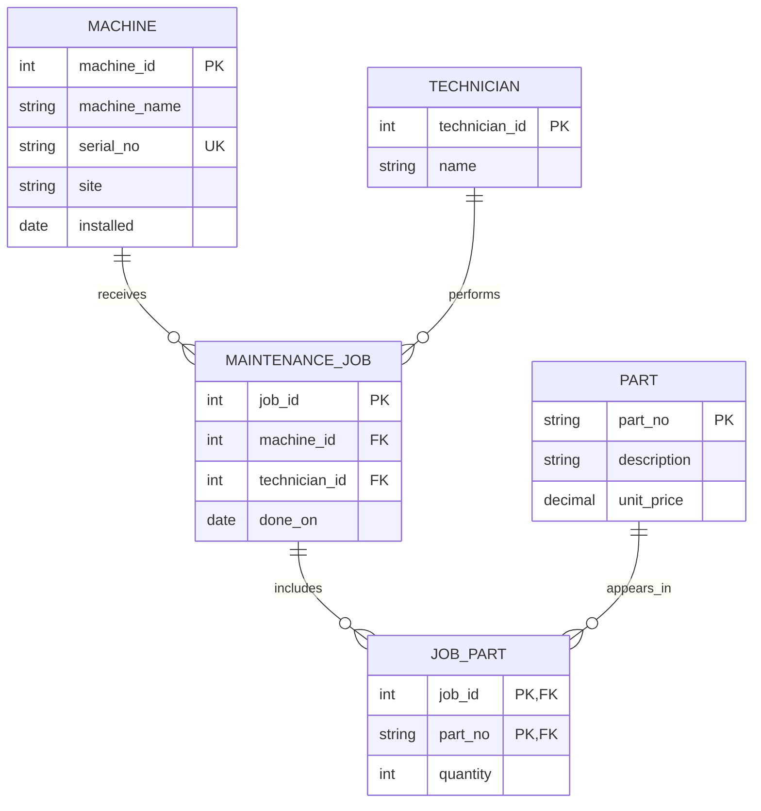

# Legacy schema ER audit

## Intended entities, attributes, and keys

The supplied tables have no declared primary keys or foreign keys. The keys below are the intended keys for a repaired design, not constraints that the legacy database currently enforces.

| Entity | Intended attributes | Intended key | Finding in the legacy data |
|---|---|---|---|
| `Machine` | `machine_id`, `machine_name`, `serial_no`, `site`, `installed` | `machine_id` (surrogate); `serial_no` should also be `UNIQUE` | `machine_name` is being used to connect jobs, but is plain text. `installed` is free text and includes `unknown`. |
| `Part` | `part_no`, `description`, `unit_price` | `part_no` (natural key) | `P-1003` occurs twice, so the legacy table does not enforce this key. Price is text. |
| `MaintenanceJob` | `job_id`, `machine_id`, `technician_id`, `done_on` | `job_id` | The legacy table stores machine and technician names as text and the parts list in one field. |
| `Technician` | `technician_id`, `name` | `technician_id` (surrogate) | Names are repeated in jobs; a separate entity would provide a stable reference. |
| `JobPart` | `job_id`, `part_no` (optionally `quantity`) | Composite key `(job_id, part_no)` | This junction table is missing; its relationship is hidden in `parts_used`. |

## Reconstructed ER diagram



Each job belongs to one machine and one technician. A machine or technician can have zero or many jobs. The junction table converts the jobs-to-parts many-to-many relationship into two one-to-many relationships.

## Cardinality findings from the sample rows

I ran the saved queries in [`cardinality.sql`](cardinality.sql). They show:

- Machine/job: `cnc-01` has 2 jobs and `cnc-02` has 1. `cnc-05` has 1 job but no matching machine, so it is an orphan rather than a valid relationship.
- Technician/job: Beier has 2 jobs; Klaas and Werther have 1 each.
- The `parts_used` field contains 2 part numbers for job 1, 1 each for jobs 2 and 3, and no parts for job 4. Exactly 1 job has more than one part.
- `P-1001` is referenced by jobs 1 and 3, while job 1 also references `P-1002`. The hidden jobs-to-parts relationship is many-to-many.

The legacy data gives examples of one-to-many and many-to-many relationships, but the schema does not enforce either with keys or constraints. It does not show a one-to-one relationship.

## Captured cardinality output

```text
machine_name  job_count
cnc-01        2
cnc-02        1
cnc-05        1

technician  job_count
Beier       2
Klaas       1
Werther     1

job_id  parts_used    n_parts
1       P-1001,P-1002 2
2       P-1003        1
3       P-1001        1
4                     0

jobs_with_multiple_parts
1
```
