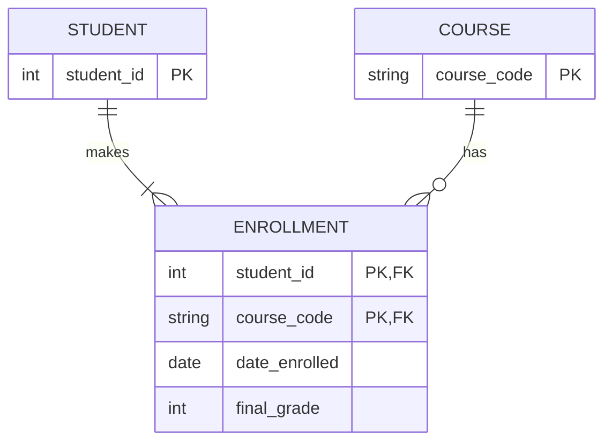
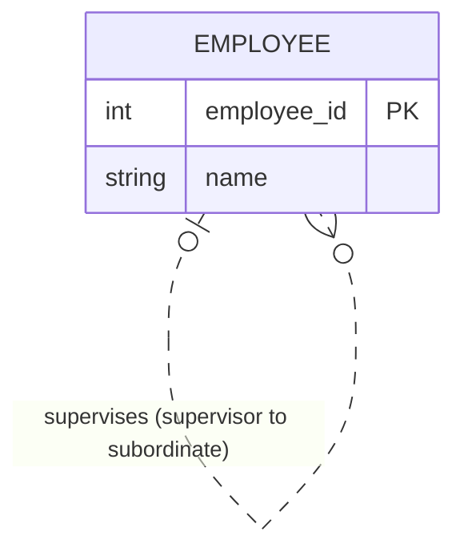
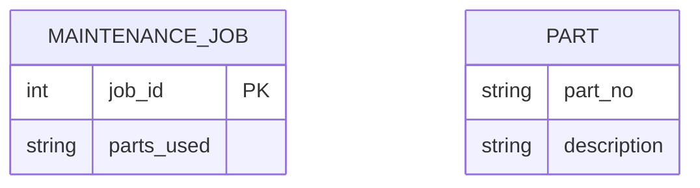
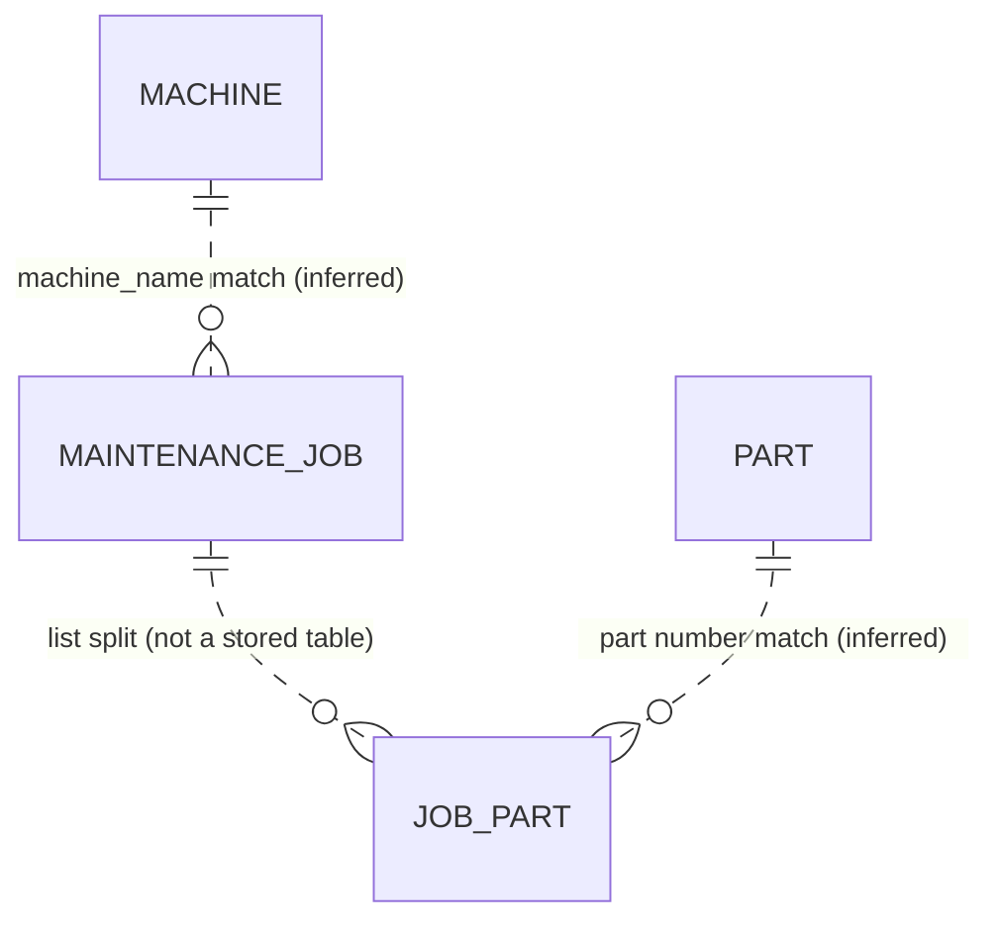

# Mermaid ER lab

The diagrams below are redraws, not copies of the source images. They are small fragments chosen to show one modeling idea each.

## Three collected examples

### Good: university enrollment as an associative entity

Source: [University Registration Data Model Example, Figure A.1](https://eng.libretexts.org/Bookshelves/Computer_Science/Databases_and_Data_Structures/Database_Design_2e_(Watt)/01:_Chapters/1.17:_Appendix_A_-_University_Registration_Data_Model_Example).

Why it is good: the many-to-many relationship is made explicit through `ENROLLMENT`, and facts about an individual enrollment (date and grade) live with that association.

### Strange: recursive employee supervision

Source: [George Washington University, ER Model Notes, slides 55–58](https://www2.seas.gwu.edu/~bhagiweb/cs2541/lectures/ER.pdf).

Why it is strange at first: the same entity appears at both ends, but those are two different roles. One employee can supervise many employees; a top-level employee may have no supervisor. Role names remove the ambiguity.

### Confusing on purpose: a many-to-many list hidden in a text field

Source: the legacy maintenance schema in the course Studio Lab; redraw created for this audit.

Why it is confusing: the diagram has no relationship line, even though the data contains relationships. Adding a direct `MAINTENANCE_JOB` to `PART` one-to-many line would also be wrong because a part can be used by many jobs. The intended model needs a `JOB_PART` junction entity.

## Schema to diagram, then verify

**Prompt used with ChatGPT:** “Given these SQLite table definitions, produce Mermaid `erDiagram` syntax. Distinguish declared foreign-key relationships from likely relationships suggested only by matching column names. Do not claim an unenforced relationship is guaranteed.”

The legacy schema has `machine.machine_name` and `maint_job.machine_name`, but declares no foreign key. It has `maint_job.parts_used` and `part.part_no`, but the former is a comma-separated string. A likely-intent redraw is:

The dashed links are inferences. `JOB_PART` does not exist in the legacy schema; it is the junction table the repaired model needs. The SQL schema itself declares none of these foreign keys.

I checked the database using `PRAGMA foreign_key_list(maint_job);` and `PRAGMA foreign_key_list(part);`: neither table declares a foreign key. The row counts in [`cardinality.sql`](cardinality.sql) show observed examples of the intended one-to-many and many-to-many relationships, including the orphan `cnc-05` job. This is why a diagram generated from names alone needs verification.

## Diagram to schema, then back to `.schema`

**Prompt used with ChatGPT:** “Convert the corrected Mermaid model of Machine, Technician, MaintenanceJob, Part, and JobPart into SQLite-compatible `CREATE TABLE` statements. Use primary keys, foreign keys, a unique machine serial number, and a composite key on JobPart.”

The resulting SQLAlchemy contract is in [`contract.py`](contract.py), and its emitted DDL is in [`contract-ddl.sql`](contract-ddl.sql). I ran that DDL in an in-memory SQLite database; [`roundtrip-schema.txt`](roundtrip-schema.txt) contains the schema SQLite reported. The core links survived: `maint_job` references `machine` and `technician`, and `job_part` references `maint_job` and `part`. The unique serial number and composite junction key also appear in the DDL.

What the model added: a surrogate `machine_id`, a `technician` table, a unique constraint on machine serial number, and a junction table. These are deliberate repairs; they cannot be inferred from the broken legacy schema alone.

## Cardinality overuse

A rule such as “a car has exactly four wheels” is usually a business constraint rather than an ER cardinality: spare wheels, trailers, and six-wheel vehicles are counterexamples. Model the relationship as a vehicle having wheels, then enforce an exact count only if the real domain requires it. An exact number belongs in cardinality only when it is an invariant of the domain and the model notation can express it clearly; otherwise use validation or database constraints.

## Inheritance overuse

A `Vehicle` supertype with `Car` and `Truck` subtypes is useful when the types share important fields and have genuinely different required attributes or relationships. If the only difference is a small label and most fields are the same, a `vehicle_type` column may be simpler. Inheritance becomes hard to manage when categories overlap or change often, such as a person who is simultaneously a customer, employee, and student; separate roles or associations can model those facts more simply.

## Share candidate

Candidate: the recursive `EMPLOYEE supervises EMPLOYEE` redraw. One-line note: “We chose this because it shows that one entity type can take two distinct roles in the same relationship.” Ask the pod to agree on the image and post it in Discord; that post still needs to be made by a pod member.
